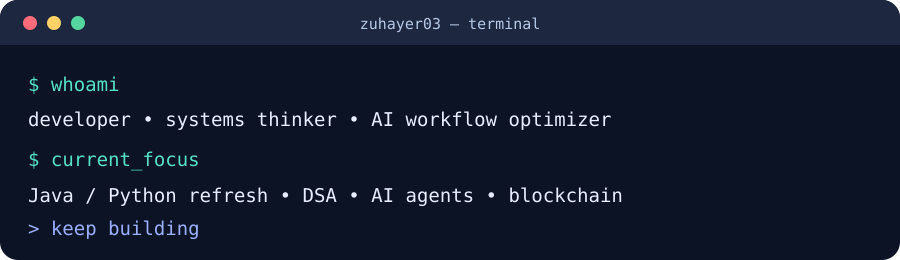

  
   
  
  
  
    
  <strong>Computer Science · AI Tool Orchestration · Workflow Optimization · Java & Python · Emerging Technologies</strong>

---

### ◈ Z-SIGMA // Experimental Mission Control

**[Launch the interactive lab (GitHub Pages)](https://zuhayer03.github.io/programming-journey/lab.html)** · **[Inspect lab source](https://github.com/zuhayer03/programming-journey/tree/main/docs)** · **[Read experiment notes](https://github.com/zuhayer03/programming-journey/blob/main/docs/EXPERIMENT.md)**

A cinematic, interactive tool-routing console with local browser demonstrations and session telemetry. **Z-SIGMA is a fictional experiment brand, not an employer or production service.** GitHub Pages must be enabled for the hosted link to work.

### 01 / The overview

I’m **Zuhayer Alam Faiyaz**, a Computer Science student bringing together programming foundations, IT troubleshooting, and a strong instinct for **finding the right tools to solve difficult problems**.

I approach development as a systems problem: research the options, design a workable flow, use AI intelligently, validate the output, and keep improving. I have studied **Java and Python** and am refreshing both alongside data structures and algorithms.

> **My edge:** combining AI literacy, rapid tool evaluation, and practical workflow design to amplify what I can build.

### 02 / Operating principles

| Discover | Orchestrate | Validate |
| :-- | :-- | :-- |
| Research frameworks, APIs, and developer tools | Connect AI assistants, automation, and conventional code | Review assumptions, test behavior, and refine the result |
| Choose tools based on the actual task | Reduce busywork and shorten iteration cycles | Keep security, maintainability, and clarity in the loop |

  

### 03 / Technical landscape

- **Engineering foundations:** Java, Python, DSA, debugging, software development coursework
- **AI-assisted engineering:** tool selection, prompt workflows, AI research, prototyping, assisted debugging
- **Exploration:** LLMs, AI agents, retrieval-augmented generation, blockchain
- **Background:** IT support, troubleshooting, networking, technical communication

### 🌐 Interactive portfolio & working AI agent

- **[Animated portfolio website source](https://github.com/zuhayer03/programming-journey/tree/main/docs)** — responsive single-page site with a custom particle background, interactive project cards, and reduced-motion support.
- **[ToolPilot agent](https://github.com/zuhayer03/programming-journey/tree/main/agent)** — runnable Python tool router with a safe calculator, word statistics, TODO extraction, execution traces, and unit tests.

**Website publishing:** GitHub Pages must be enabled for the `main` branch and `/docs` folder in repository Settings → Pages. Once enabled, the site should be available at `https://zuhayer03.github.io/programming-journey/`.

### 04 / Repository map

| Workspace | What you’ll find |
| :-- | :-- |
| **[Programming Journey](https://github.com/zuhayer03/programming-journey)** | My programming refresh, DSA notes, learning log, and project progression |
| **[Java Code](https://github.com/zuhayer03/javaCode)** | Earlier Java coursework and practice |

**Explore this repository:** [Java](java/README.md) · [Python](python/README.md) · [DSA](dsa/README.md) · [Projects](projects/README.md) · [Learning log](LEARNING_LOG.md)

### 05 / Activity signal

Activity cards are generated from public GitHub data by an external service, may be delayed, and may occasionally fail to load. They do not measure professional experience.

---

  <h3>Build intelligently. Automate thoughtfully. Ship responsibly.</h3>
  Designed to evolve with real projects, code, and measurable engineering outcomes.

