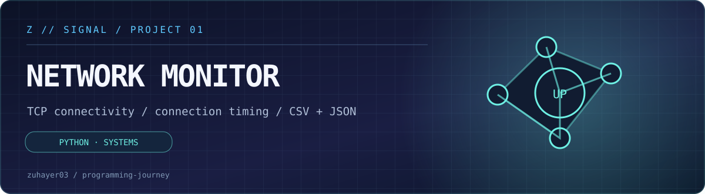
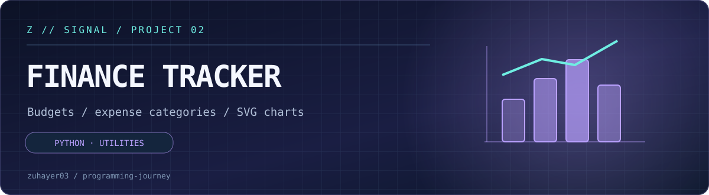
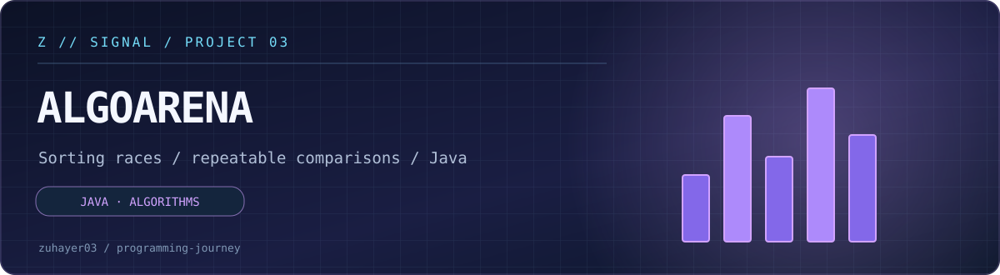
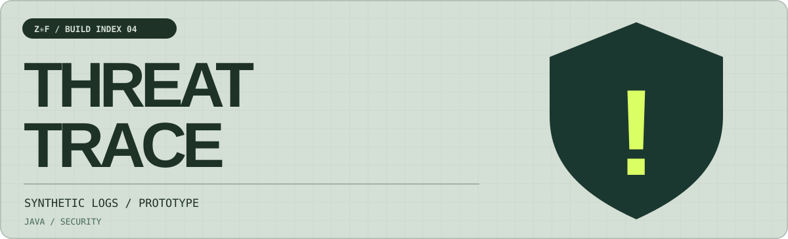

# Z // SIGNAL · PROJECT ARCHIVE

**Four projects. Two languages. Practical learning.**

[← Portfolio home](../README.md) · [↗ Public website](https://zuhayer03.github.io/programming-journey/) · [↗ GitHub profile](https://github.com/zuhayer03)

### 01 · Network Monitor

**[Open source and tests →](network-monitor/)** · Python · TCP connection checking and CSV/JSON reports · Working student project

### 02 · Finance Tracker

**[Open source and tests →](finance-tracker/)** · Python · Category expenses, budgets, and SVG spending chart · Working student project

### 03 · AlgoArena

**[Open source and tests →](algoarena/)** · Java · Three sorting methods and educational timing comparisons · In development

### 04 · ThreatTrace

**[Open source and tests →](threattrace/)** · Java · Synthetic login-event log parsing and failed-login thresholds · Functional prototype

---

### Notes for reviewers

All four folders include code, setup instructions and test files. **These are educational console programs, not deployed products.** AlgoArena's richer visual simulator is future work; ThreatTrace runs against synthetic data rather than a live security feed. Python monitor probes only configured TCP services, not general ICMP hosts. This distinction is important.

[← Back to programming-journey](../README.md)